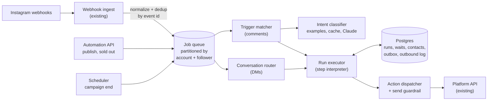
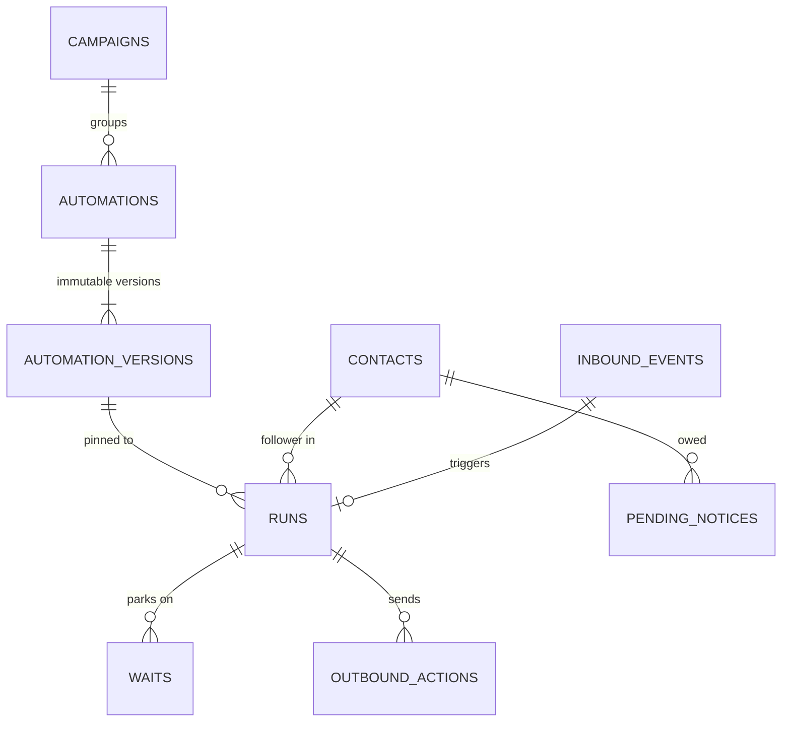
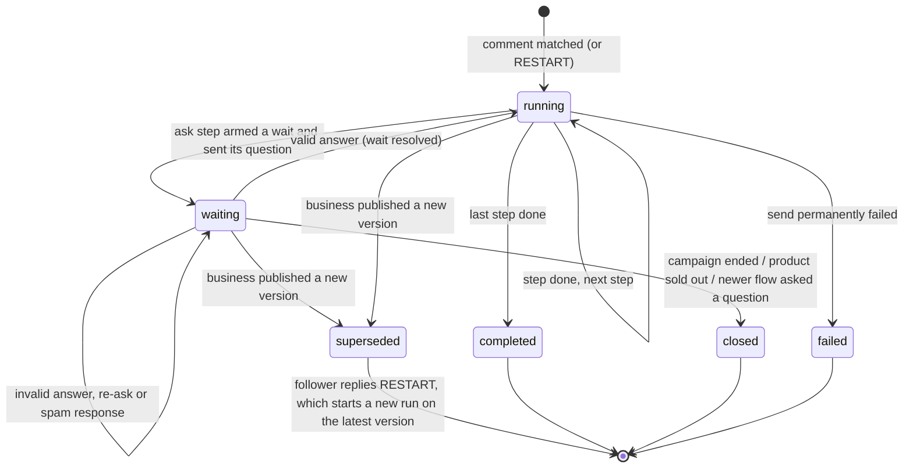
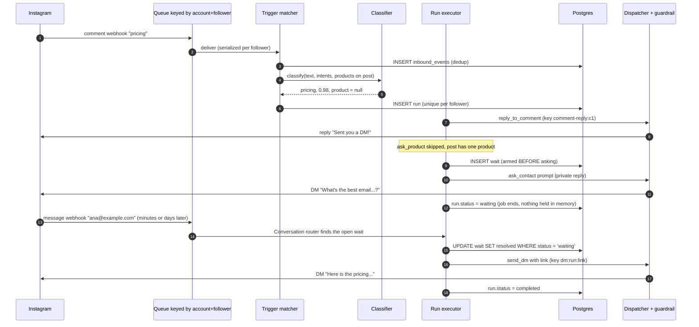
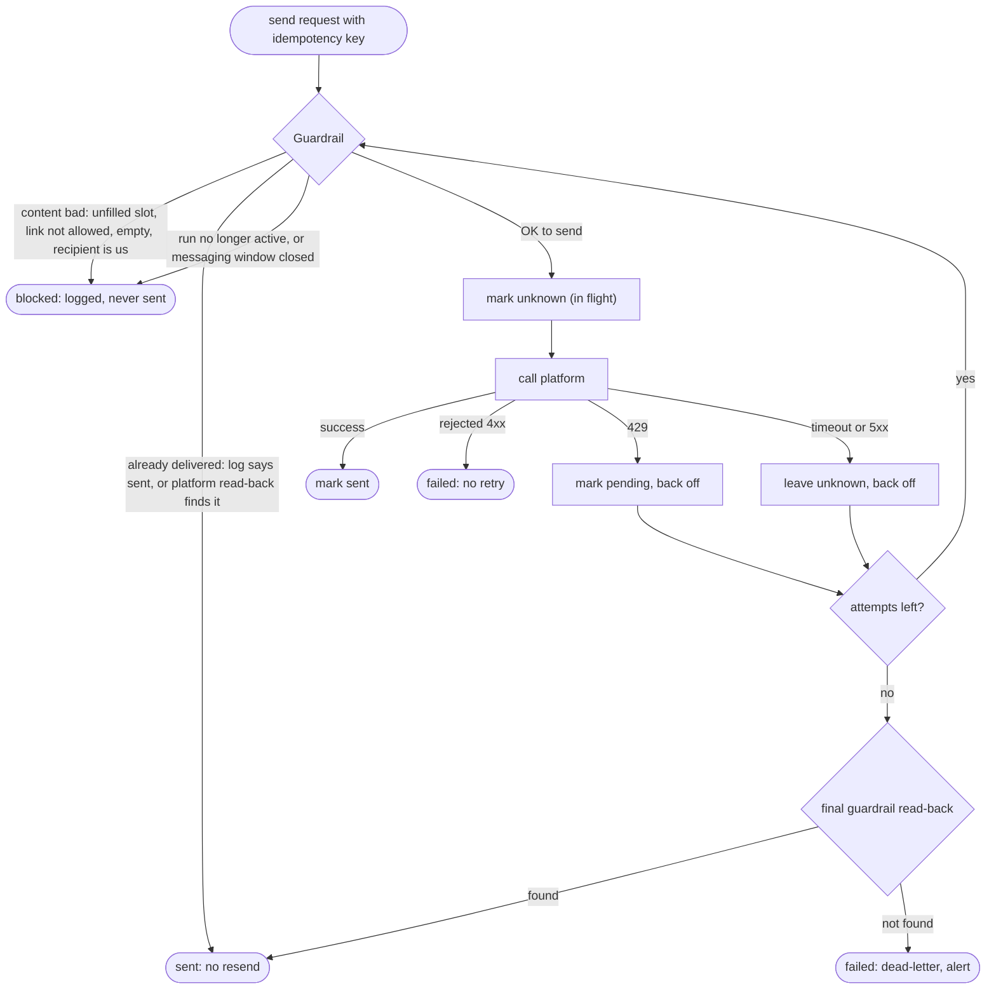

# Comment-triggered automations: backend design

A business sets up an automation once. From then on, when a follower comments on one of its posts asking about price, in any language, the system:

1. replies to the comment ("Sent you a DM!"),
2. DMs the follower, asking which product if the post shows several and then for an email,
3. waits for the answers, for as long as the campaign runs,
4. DMs the link once it has what it needs.

This document covers the architecture, data model, and execution model, plus the reliability and concurrency behavior. The reasoning behind each major choice is in [DECISIONS.md](DECISIONS.md), which also records who made each decision. A runnable TypeScript reference implementation of the core engine lives in [`src/`](../src) and the Postgres schema in [`db/schema.sql`](../db/schema.sql).

**Contents**
1. [Scope and assumptions](#1-scope-and-assumptions)
2. [The flow in practice](#2-the-flow-in-practice)
3. [How general the system is](#3-how-general-the-system-is)
4. [Architecture](#4-architecture)
5. [Data model](#5-data-model)
6. [Execution model](#6-execution-model)
7. [Reliability](#7-reliability)
8. [Concurrency](#8-concurrency)
9. [Intent detection](#9-intent-detection)
10. [Platform constraints](#10-platform-constraints)
11. [Scale and multi-tenancy](#11-scale-and-multi-tenancy)
12. [Observability](#12-observability)
13. [Alternatives considered](#13-alternatives-considered)
14. [What the reference implementation covers](#14-what-the-reference-implementation-covers)
15. [Open questions](#15-open-questions)

Terms: the **business** owns social accounts and automations. A **follower** is the person who comments and receives DMs. A **run** is one follower's trip through one automation.

---

## 1. Scope and assumptions

**Given by the brief.** The platform layer can already receive comment and message webhooks, reply to comments, and send DMs.

**Assumed in addition:**
- The business has a catalog that says which products each post shows. Instagram product tags or a manual mapping both work.
- Automations belong to a **campaign** with an end date. The business can mark products sold out.
- The platform layer can **read back recent messages** we sent in a conversation or comment thread. The send guardrail uses this to confirm whether an ambiguous send arrived (§7). Meta's APIs expose conversation and comment reads. If this were unavailable, the guardrail would fall back to "don't resend after an ambiguous failure" and trade a possible missed message for no duplicates.

**Out of scope:**
- Restricting automations to specific posts (decision 3). Every post on the connected account can trigger.
- The builder UI, analytics UI, and handoff to a human agent.
- Platforms other than Instagram, although nothing in the core engine is Instagram-specific. Platform rules live in the guardrail and adapter.

## 2. The flow in practice

**One product on the post.** Nothing is ambiguous, so the flow is the fixed four steps from the brief.

| Follower does | System does |
|---|---|
| Comments "pricing" | Classifies intent as `pricing`. Starts a run, replies "Sent you a DM!", sends a private-reply DM asking for an email, and parks the run on a wait. |
| DMs "sure, ana@example.com" | Routes the DM to the waiting run, extracts the email, saves it on the contact, and DMs the link. The run completes. |

**Three products on the post.** The product is ambiguous, so one follow-up question is added.

| Follower does | System does |
|---|---|
| Comments "¿Cuánto cuesta?" | The LLM tier classifies it as `pricing` in Spanish. Starts a run, replies to the comment, and DMs "Which product? 1. Classic Tee 2. Hoodie 3. Cap". |
| DMs "2" | Picks the Hoodie and asks for an email. |
| DMs "no tengo email" | It is not an email or a phone number, so the system re-asks. |
| DMs "+34 612 345 678" | Phone is the accepted fallback. The system sends the Hoodie link. |

If the comment had said "how much is the hoodie?", the product question would have been skipped. Run `npm run demo` to see these and six more scenarios end to end.

## 3. How general the system is

> Decision 1 (author): *a fixed flow when the situation is deterministic, follow-ups only when something is ambiguous.*

An automation is **data, not code**: a trigger plus an ordered list of steps from a small typed catalog.

| Step | What it does | When it is skipped |
|---|---|---|
| `reply_to_comment` | Public reply to the triggering comment | Never. It is idempotent per comment, so a restarted run doesn't reply twice. |
| `ask_product` | "Which product?" with a numbered list. Accepts a number or a product name or alias. | The post shows one in-stock product, or the comment already named one. |
| `ask_contact` | Asks for an email. A phone number is the fallback. | The business already has this follower's email or phone. |
| `send_dm` | Sends a templated DM with `{{product.name}}` and `{{product.link}}` | Never |

The key property is that **ask steps skip themselves when the answer is already known**. One definition therefore behaves as a fixed flow in the deterministic case and asks only the follow-ups that are actually needed.

**Why not a fixed, hard-coded template?** The very first variation in the brief, a post with three products, already needs a different shape. Every new use case would become engineering work.

**Why not a general workflow graph with branches, loops, and parallel paths?**
- A linear list with self-skipping steps covers the comment-to-DM funnels this feature exists for: trigger, clarify, capture, deliver.
- It is easy to validate at publish time. For example, a `{{product.name}}` placeholder before any `ask_product` step is rejected.
- It is easy to show in a UI, and easy to reason about when versioning, retrying, and restarting.
- A graph engine makes each of those harder for flexibility nobody has asked for yet.

**How it extends.** New step types are additive: tag a contact, call a webhook, add a delay, apply a discount code. Each one is a new case in the interpreter and a new JSON shape, with no schema migration. If real branching is ever needed, the natural next step is outcome-based `next` pointers on a step, such as `on_valid` and `on_timeout`. Arbitrary graphs would come after that.

## 4. Architecture

| Component | Responsibility | Reference code |
|---|---|---|
| Webhook ingest | Exists already. Normalizes platform payloads into `comment` and `message` events and enqueues them with partition key `account:follower`. | `src/domain/types.ts` (event shapes) |
| Trigger matcher | Deduplicates by event id. Ignores our own comments. Classifies intent once per comment against every intent the account listens for, picks at most one automation, and starts a run. | `src/engine/triggers.ts` |
| Intent classifier | Tiers: example phrases, then a cache, then an LLM. Returns the intent, a confidence, and any product mentioned. | `src/intent/` |
| Conversation router | Deduplicates and drops echoes. Records the inbound message, which opens the messaging window. Delivers owed notices, handles RESTART, finds the follower's open wait, and validates the answer. | `src/engine/conversation.ts` |
| Run executor | Interprets the step list. Persists after every step, and parks the run on a wait when it asks a question. | `src/engine/executor.ts` |
| Action dispatcher | The only path to the platform. Runs the guarded send loop (§7) with idempotency keys, backoff, and per-account rate limiting. | `src/dispatch/` |
| Automation API | Publishes immutable versions, which supersedes runs on older versions, and marks products sold out. | `src/lifecycle/lifecycle.ts` |
| Scheduler | Fires "campaign ended" at the campaign's end time. Waits themselves have no timers. | `Lifecycle.sweepCampaigns` |

Every component except the classifier's LLM call is plain CRUD on Postgres plus a queue. These are stateless workers that scale horizontally.

## 5. Data model

The full DDL is in [`db/schema.sql`](../db/schema.sql). It is checked against a real Postgres engine.

| Table | Purpose | Key constraint and what it guarantees |
|---|---|---|
| `automation_versions` | Immutable `{trigger, steps}` JSON | PK `(automation_id, version)`. A published flow never changes under a running follower. |
| `inbound_events` | Every webhook event, plus the classifier result for audit | PK `platform_event_id`. A redelivered webhook is a no-op. |
| `runs` | One follower's progress: `status`, `step_index`, `context` (product, email, phone, invalid attempts), `row_version` | `UNIQUE (automation_id, trigger_event_id)`. Partial `UNIQUE (automation_id, follower_id) WHERE status <> 'superseded'`, which means **each follower gets the flow once**. |
| `waits` | An open question: kind, offered options, status | Partial `UNIQUE (social_account_id, follower_id) WHERE status = 'waiting'`. **An incoming DM maps to exactly one run.** |
| `contacts` | Captured email or phone, `last_inbound_at` for the messaging window, spam bookkeeping | PK `(social_account_id, follower_id)` |
| `pending_notices` | Messages owed while the messaging window was closed | Delivered and deleted on the follower's next message |
| `outbound_actions` | One row per logical message, keyed by idempotency key, with status `pending`, `unknown`, `sent`, `failed`, or `blocked` | PK `idempotency_key`. Partial unique index on one sent private reply per comment. |
| `jobs` | Outbox and work queue | Written in the same transaction as the state change that schedules it |

**Idempotency keys are chosen per logical message, not per attempt.**

| Message | Key |
|---|---|
| Comment reply | `comment-reply:<commentId>` |
| Question | `dm:<runId>:<stepId>:prompt` |
| Final DM | `dm:<runId>:<stepId>` |
| Re-ask | `dm:<runId>:reask:<n>` |

The comment-reply key is per comment, not per run. That is why a run restarted after a version change doesn't reply to the comment again.

## 6. Execution model

### Run lifecycle

### One comment, end to end

### The interpreter loop

`advance(run)` executes steps from `run.step_index` until one of three things happens:
- A step asks a question. The run becomes `waiting` and the job ends.
- The steps run out. The run becomes `completed`.
- A step fails permanently. The run becomes `failed`.

After every step, the run row is updated with an optimistic-concurrency check on `row_version`.

In production, each `advance` is a **job**, and the run update and the next job's insert are committed in **one transaction** (transactional outbox). A crash between steps leaves either the old state with the old job, or the new state with the new job, never a half-step. Outbound sends are not inside that transaction. They are made idempotent separately (§7).

### Waits are rows, not sleeping processes

A follower may answer in ten seconds or ten days. Nothing is held in memory while we wait. The wait is a row in `waits`, and the run is a row in `waiting` state. A million parked conversations cost a million small rows, not a million timers or workflow threads.

> Decision 7 (author): *a wait lasts until the campaign ends or the product sells out.*

So there is **no per-wait timeout**. Waits are closed by business events:

| Event | What happens to open waits | How the follower finds out |
|---|---|---|
| Campaign end time reached (scheduler) | Every running or waiting run in the campaign is closed with `campaign_ended`. The automation is paused. | On their next message: "This campaign has ended." |
| Product marked sold out | Runs that **chose** that product are closed with `sold_out`. Runs still **choosing** just stop being offered it, and are closed only if every option on their post is gone. | On their next message. If they pick the sold-out item, the product question is asked again with the remaining options. |

Telling followers lazily, on their next message, is deliberate. A message they send opens the platform's messaging window, so the notice is always deliverable, and nobody is pushed an unsolicited "this ended" DM.

### Versioning and restart

> Decision 4 (author): *the business owns the flow. When it changes, followers mid-flow are asked to restart, so everyone ends up consistent with the new version.*

- Publishing creates version *n+1* and makes it current. New comments start on it.
- Every `running` or `waiting` run on an older version is marked `superseded`, and its wait is cancelled.
- The follower is sent "We've updated this offer. Reply RESTART to start again." This happens immediately if the messaging window is open, and otherwise on their next message.
- RESTART starts a **new run** on the current version for the same comment.
  - The one-per-follower constraint ignores superseded runs, which is what allows the new run.
  - The comment reply is not repeated, because of the per-comment idempotency key.
  - A product already chosen is kept if it is still in stock. Everything else is asked again under the new flow.
- A late answer to the old question finds no open wait, so it can't continue the old flow.

## 7. Reliability

The overall approach is **at-least-once everywhere, made effectively-once by idempotency**. We don't depend on exactly-once delivery from any queue or platform.

### The guarded send loop

> Decision 9 (author): *a loop where a guardrail first confirms the message, and then sends.*

The guardrail answers three questions before **every** attempt, including retries:

1. **Is the message right?** It checks for no unfilled `{{slots}}`, no empty text, links only to the business's allowed domains, and that the recipient is not our own account. These are cheap, deterministic checks that catch broken templates before a follower sees them. In testing, this check caught a real bug in the reference implementation: unrendered prompts.
2. **Has it already been delivered?** If our log says `sent`, the answer is yes. If it says `unknown`, an earlier attempt timed out or a worker crashed mid-call, so we read the conversation back from the platform and look for that exact text after the first attempt. This is what turns a timeout into either "it arrived, stop" or "it didn't, resend" instead of a guess.
3. **Are we still allowed to send it?** The run must still be active, since it may have been superseded or closed while we backed off. The platform's messaging rules must also allow it (§10).

The record is written as `unknown` **before** the platform call. If the worker dies mid-call, the retried job doesn't blindly resend. It reconciles first.

### Failure catalog

| Failure | Handling |
|---|---|
| Webhook delivered twice, or out of order | Dedup on `platform_event_id`. Per-follower partitioning orders events by arrival. Correctness doesn't depend on order: waits are armed before questions, and every transition is a conditional update. |
| Worker crashes between steps | The outbox job lease expires and the job re-runs. The run row still shows the last committed step, and steps are idempotent through their send keys. |
| Worker crashes during a send | The record is `unknown`, so the guardrail reconciles before resending. |
| Platform timeout or 5xx | Backoff with jitter, then the guardrail read-back before the next attempt. |
| Platform 429 | Delay, never drop. A per-account token bucket in the dispatcher keeps us under limits proactively. |
| Platform 4xx, such as an invalid recipient | The send fails without retry. A failed final DM marks the run `failed` with a reason. A failed comment reply doesn't stop the DM flow. |
| Token revoked or account disconnected | The account is marked `token_revoked` and its jobs are paused, not failed. They resume on reconnect. |
| LLM tier down or slow | The classifier times out and falls back to the example tier only. Uncertain means no run: a missed comment is cheaper than a wrong DM. Server-side model fallback covers refusals. |
| Notice can't be sent because the window is closed | Stored in `pending_notices` and delivered on the next inbound message. |
| Poison job, such as a bad definition or a bug | After max attempts it moves to the dead-letter queue with an alert. Definitions are validated at publish time to make this rare. |

## 8. Concurrency

Three mechanisms layer on each other. Any one of them alone would leave gaps.

1. **Per-follower serialization.** The queue is partitioned by `social_account_id:follower_id`. That follower's comments, DMs, and lifecycle changes to their runs are processed one at a time. Different followers run fully in parallel, and there is no global lock. In the reference code this is `KeyedSerialQueue`. In production it is an SQS FIFO message group, a Kafka key, or `SKIP LOCKED` per partition key.
2. **Optimistic locking.** Every run update is `WHERE id = $1 AND row_version = $2`. If partitioning ever breaks, for example during a consumer rebalance, a stale writer gets zero rows and retries from fresh state instead of overwriting.
3. **Database constraints and conditional updates.** They are the last line of defense: one run per follower per automation, one open wait per follower, and `UPDATE waits ... WHERE status = 'waiting'`, which exactly one caller can win.

| Race | What happens |
|---|---|
| Follower answers before the question's wait exists | Can't happen. The wait is inserted **before** the question is sent, so any reply finds it. Tested by firing the comment and the answer concurrently. |
| Two valid answers arrive together | Serialized. The first resolves the wait and completes the run. The second finds no open wait and goes to the business's inbox. Exactly one link is sent. |
| Answer and campaign end at the same moment | Both go through the follower's partition, and the wait closes through a conditional update. The run ends either `completed` with the link or `closed` without it, never both. |
| Answer and new version publish | Same mechanism. The publish's per-run work is enqueued on the follower's partition. |
| The same comment webhook delivered twice, concurrently | `inbound_events` dedup, backed by `UNIQUE (automation_id, trigger_event_id)` |
| Follower comments on two posts at once | Serialized by follower. The second hits the one-per-follower constraint and returns `already_received`. |
| Two automations want to ask the same follower something | One open wait per follower, and the **newest question wins**. The older run is closed with `replaced_by_newer_flow`. The follower is answering the last thing we asked, and this keeps DM routing unambiguous. |
| One comment matches two automations | At most one automation per comment: the most recently published one. Two flows DMing the same person at once reads as spam. |
| Viral post, thousands of followers at once | No shared row is written per comment. Each follower touches only their own run, wait, and contact rows, so throughput scales with workers. |

## 9. Intent detection

> Decision 2 (author): *the point is intent, not the keyword. "Pricing" may come in other languages, as synonyms, or as a whole sentence.*

The classifier takes the comment, every intent the account's live automations listen for, and the products on the post. It returns `{intent, confidence, productId, language}`.

| Tier | What it does | Cost |
|---|---|---|
| 1. Example phrases | Normalizes case, accents, and punctuation, then matches the business's multilingual example phrases as whole words. "PRICE??" and "precio" match. "repricing" does not. | Free, in-process |
| 2. Cache | Keyed by normalized text, intents, and post products. Viral posts repeat the same few comments, so this absorbs most volume. | Free |
| 3. LLM | One structured-output Claude call per uncached comment. It handles paraphrases ("what would this set me back?"), other languages, and product mentions ("¿y la sudadera?"). | One small request |

**Design points:**
- **Bias toward doing nothing.** Each automation has `minConfidence`, defaulting to 0.7. A false positive is an unsolicited DM, which annoys followers and risks the account's standing with the platform. A false negative is one missed lead.
- **One call covers all intents.** The comment is classified once against everything the account listens for, not once per automation.
- **The comment is untrusted input.** It is wrapped in tags and the system prompt says to treat it as data. The output is schema-constrained, with enums limited to the offered intents and products, so an injected "ignore previous instructions" can at worst produce a wrong classification, never an action.
- **Product mention doubles as slot filling.** If the comment already names a product, the `ask_product` step skips itself.
- **Auditability.** The classifier result is stored on `inbound_events`, so "why did this person get a DM?" has an answer.
- **Model.** The default is Claude Opus 5.5 at low effort, with server-side fallback on refusals. It is configurable through `INTENT_MODEL`. A smaller model would cut cost substantially, but that tradeoff is the business's to make. It should be decided against a labelled set of real comments, which is also how `minConfidence` should be tuned.

## 10. Platform constraints

Instagram, at the time of writing, allows:
- One **private reply** DM per comment, within days of the comment.
- Normal DMs only within **24 hours** of the follower's last message to us.

Verify both against current Meta policy before launch. The design is shaped around them:

- The **first** DM in a run goes out as the comment's private reply. Every later DM is a response to something the follower just sent, so it is inside the window.
- The guardrail picks the channel: a normal DM if the window is open, else the comment's private reply if it is unused, else **blocked**. It never sends out of policy.
- Notices that can't be sent, such as campaign ended, sold out, or flow updated with a closed window, wait in `pending_notices` for the follower's next message.
- **Loop prevention.** Our own "Sent you a DM!" reply arrives as a comment webhook and is ignored because the author is the business account. DM echoes are ignored using the platform's echo flag.
- **Messages that aren't for us.** A DM with no open wait is left for the business's normal inbox. The automation never answers conversations it didn't start.

## 11. Scale and multi-tenancy

- **Bursts.** A viral post can produce thousands of comments a minute. Ingest is a cheap insert plus enqueue. Classification is mostly cache hits. Outbound sends are throttled per account by a token bucket, so the queue absorbs the burst and sends drain at the platform's allowed rate.
- **Tenant fairness.** One business's viral post must not starve everyone else. Workers pull with weighted round-robin across accounts, not plain FIFO over the whole queue.
- **Data growth.** `runs`, `waits`, and `outbound_actions` grow with engagement. Partial indexes keep the hot paths on **open** rows only: active runs, open waits, and ready jobs. Old completed rows can be partitioned by month and archived.
- **No hot rows.** Per-comment work writes only that follower's rows. The only shared reads are the account's active automations, which are cacheable and invalidated on publish.

## 12. Observability

- **Per-run timeline.** Every event, classification, step, send attempt, and guardrail verdict, keyed by run id. This is what support uses to answer "why did or didn't this person get a DM?"
- **Funnel metrics per automation:**
  - comments
  - matched, broken down by tier
  - runs started
  - product chosen
  - contact captured, split by email and phone
  - link delivered
  - closed, broken down by reason
- **Health metrics:**
  - send outcomes by status
  - guardrail blocks by reason, where a spike means a broken template or link
  - ambiguous-send reconciliation results
  - 429 rate
  - LLM latency, cost, and error rate
  - queue lag per partition
  - dead-letter depth
- **Alerts:** dead-letter growth, a sustained rise in guardrail blocks, a `token_revoked` account, and LLM error rate above threshold.

## 13. Alternatives considered

| Option | Why not, for now |
|---|---|
| **Temporal or another durable-workflow engine** (decision 5, made by AI) | It is a good fit for "wait for a signal, then continue". But automations here are data-defined and short, and we need to **query** state across runs: who is waiting, conversion, everyone on product X. That is natural in SQL and awkward through workflow visibility APIs. A Postgres state machine plus an outbox reuses infrastructure the team likely already runs. It is worth revisiting if flows grow into long, branching, multi-service processes. |
| Fixed template, or a general workflow graph | See §3. |
| Keyword matching | Fails the author's core requirement of other languages, synonyms, and sentences. Kept only as the cheap first tier. |
| Timers on waits | Replaced by business events (decision 7). A timer would end conversations the business still wants open. |
| Exactly-once infrastructure, such as Kafka transactions | Platform APIs are outside any transaction, so we would need idempotent sends anyway. Idempotency keys plus a reconciling guardrail solve the real problem once. |

## 14. What the reference implementation covers

| Design concept | Code | Tests |
|---|---|---|
| Step catalog, self-skipping asks | `src/engine/executor.ts` | `test/flow.test.ts` (decision 1) |
| Tiered intent detection | `src/intent/` | `test/flow.test.ts` (decision 2), `test/intent.test.ts` |
| Versioning and restart | `src/lifecycle/lifecycle.ts` | `test/lifecycle.test.ts` (decision 4) |
| Email or phone capture, spam handling | `src/engine/conversation.ts` | `test/flow.test.ts` (decision 6) |
| Campaign-end and sold-out waits | `src/lifecycle/lifecycle.ts` | `test/lifecycle.test.ts` (decision 7) |
| Dedup, once per follower | `src/store/store.ts`, `src/engine/triggers.ts` | `test/flow.test.ts` (decision 8) |
| Guarded send loop | `src/dispatch/` | `test/dispatcher.test.ts` (decision 9) |
| Per-follower serialization, constraints | `src/util/keyed-queue.ts`, `src/store/store.ts` | `test/concurrency.test.ts` |

**Simplified on purpose:**
- The store is in memory but enforces the same unique constraints, conditional updates, and optimistic locking as the SQL schema.
- The queue is an in-process keyed serializer.
- The outbox is the interpreter loop itself.
- There is no HTTP layer and no per-account token bucket.
- The platform and the LLM tier are fakes in tests. The real Claude classifier is implemented and its request shape is unit-tested.

## 15. Open questions

- **Is "once" per automation or per product?** Today a follower who got Tee pricing doesn't get Hoodie pricing from a different post's comment. That is a strict reading of decision 8.
- **Should replies be localized?** We already detect the comment's language.
- **Consent and retention for captured emails and phones.** Covers GDPR and CCPA, plus a STOP or unsubscribe keyword that cancels runs and suppresses future ones.
- **Handoff to a human** when a follower asks something the flow can't answer.
