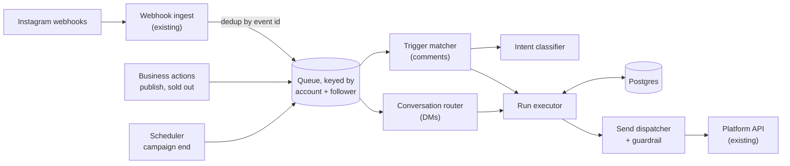
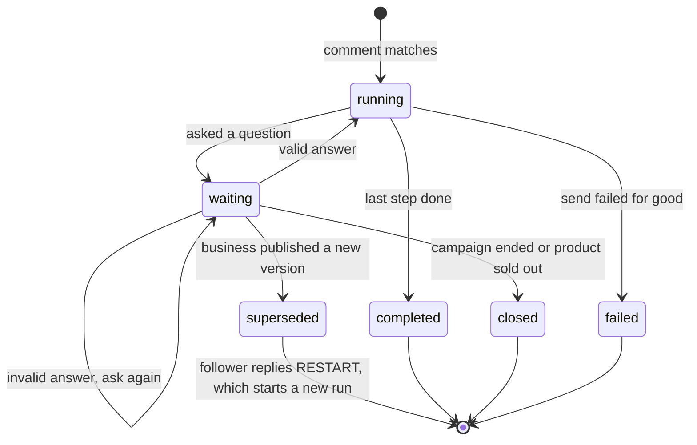
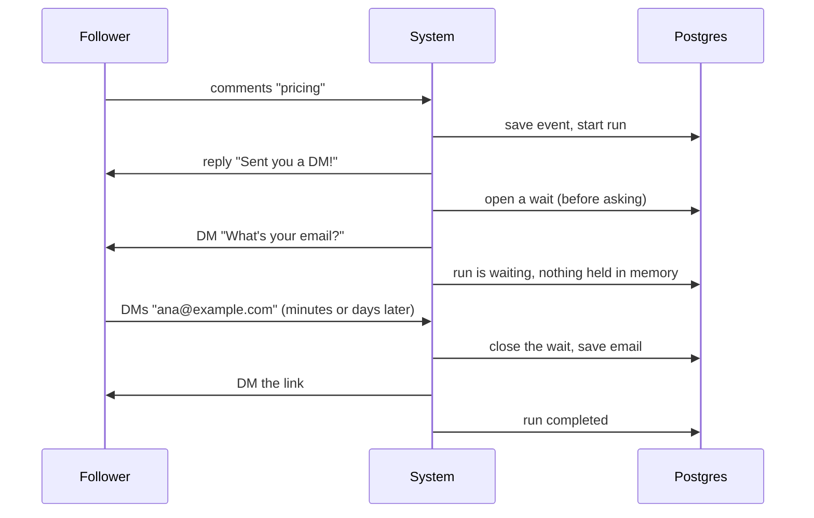

# Comment automations: design

A business sets up an automation once. When a follower comments asking about price, in any language, the system:

1. replies to the comment ("Sent you a DM!"),
2. DMs the follower, asking which product if the post shows several, then asking for their email,
3. waits for the answers,
4. DMs the link.

The reasoning behind each choice is in [DECISIONS.md](DECISIONS.md). The code is in [`src/`](../src) and the Postgres schema is in [`db/schema.sql`](../db/schema.sql).

**Sections:** [Scope](#1-scope) · [How general](#2-how-general-is-it) · [Architecture](#3-architecture) · [Data model](#4-data-model) · [How it runs](#5-how-it-runs) · [Reliability](#6-reliability) · [Concurrency](#7-concurrency) · [Intent detection](#8-intent-detection) · [Instagram rules](#9-instagram-rules) · [Scale](#10-scale-and-monitoring) · [Alternatives](#11-alternatives-considered) · [Code](#12-code-and-open-questions)

**Terms used here:**
- **Business:** owns the automation.
- **Follower:** comments on a post and receives the DMs.
- **Run:** one follower's trip through one automation.

## 1. Scope

- **Given by the brief:** we can receive comments and DMs, reply to comments, and send DMs.
- **Assumed:**
  - We know which products each post shows.
  - Automations belong to a campaign that has an end date.
  - We can read back recent messages we sent, to confirm a send that timed out.
- **Out of scope:** limiting automations to specific posts, the builder UI, and handing a conversation to a human.

## 2. How general is it?

An automation is **data, not code**: one trigger plus a short list of steps.

| Step | Does | Skipped when |
|---|---|---|
| `reply_to_comment` | Public reply to the comment | Never. It runs once per comment, even after a restart. |
| `ask_product` | "Which product?" with a numbered list | The post shows one product, or the comment already named one |
| `ask_contact` | Asks for an email. A phone number also works. | We already have their email or phone |
| `send_dm` | Sends a DM such as "Here's the link for {{product.name}}" | Never |

Questions **skip themselves when the answer is already known**. One definition is therefore a fixed flow in the simple case and asks only what it has to.

**Why not a fixed template?** A post with three products already needs a different flow.

**Why not a full workflow graph?** A short list is easy to validate, show in a UI, version, and retry. A graph adds flexibility nobody needs yet. New step types, such as tagging a contact, calling a webhook, or adding a delay, can be added without changing the model.

## 3. Architecture

| Part | Job |
|---|---|
| Trigger matcher | Skips duplicates and our own comments, checks intent, and starts at most one run |
| Intent classifier | Works out what the comment means ([§8](#8-intent-detection)) |
| Conversation router | Matches a DM to the run waiting on that follower and checks the answer |
| Run executor | Runs the steps and saves progress after each one |
| Send dispatcher | The only way messages leave. It checks every message before sending ([§6](#6-reliability)). |
| Business actions and scheduler | Publish new versions, mark products sold out, end campaigns |

All of these are stateless workers on Postgres and a queue, so they scale by adding workers.

## 4. Data model

The full SQL is in [`db/schema.sql`](../db/schema.sql). It was tested on a real Postgres engine.

| Table | Holds | Key rule |
|---|---|---|
| `automation_versions` | Each saved version of a flow | Never edited. Runs stay on their version. |
| `inbound_events` | Every webhook received | Unique event id, so a repeated webhook is ignored |
| `runs` | Each follower's progress: step, chosen product, email | **One run per follower per automation** |
| `waits` | An open question waiting for an answer | **One open question per follower**, so a DM always maps to one run |
| `contacts` | Captured email or phone, and their last message time | One row per follower |
| `pending_notices` | Messages we owe but can't send yet | Sent on their next message |
| `outbound_actions` | Every message we send | Unique key per message, so it is never sent twice |
| `jobs` | Work to do next | Saved in the same transaction as the progress it follows |

Each message has a fixed key, for example `comment-reply:<commentId>` or `dm:<runId>:<stepId>`. Retrying with the same key can't send a second copy.

## 5. How it runs

- **One step at a time.** After each step, the run's progress and its next job are saved in one transaction. A crash can't skip or repeat a step.
- **Waiting costs nothing.** A wait is just a database row, not a sleeping process.
- **The wait opens before the question is sent.** A follower who answers instantly always finds it.
- **No timers.** A wait ends when the follower answers, the campaign ends, or the product sells out. Anyone affected is told on their next message, which is always allowed by the platform.
- **Versions.**
  - Publishing an edit creates a new version, and new comments use it.
  - Followers in the middle of a flow are asked to reply RESTART.
  - RESTART starts them on the new version. It doesn't post the comment reply again, and it keeps their chosen product if it is still in stock.

## 6. Reliability

Every event can arrive more than once, so every step is safe to repeat.

**Sending a message** is a short loop. Before each attempt, a guardrail asks three things:

1. **Is the message right?** It must have no blank placeholders and only allowed links, and it must not be addressed to ourselves.
2. **Was it already delivered?** It checks our log. After a timeout, it reads the conversation back from Instagram.
3. **Can we still send it?** The run must still be active, and Instagram's messaging rules must allow it.

Only then does it send. A timeout becomes either "it arrived, stop" or "it didn't, try again", never a double message. The message is marked "in flight" before the call, so a crashed worker reconciles before it retries.

| What goes wrong | What happens |
|---|---|
| Webhook arrives twice | Ignored, because the event id was already seen |
| Worker crashes mid-step | The job is retried from the last saved step |
| Send times out | The guardrail checks whether it arrived before resending |
| Rate limited (429) | Wait and retry. Never dropped. |
| Permanent error (4xx) | No retry. The run is marked failed with the reason. |
| Account disconnected | Its jobs pause and resume on reconnect |
| LLM down or slow | Treated as "no match". No DM is safer than a wrong DM. |
| A job keeps failing | Moved to a dead-letter queue, and someone is alerted |

## 7. Concurrency

Three layers work together:

1. **One follower at a time.** The queue is keyed by account and follower, so one person's events run in order. Different people run in parallel.
2. **Version check on every update.** If two workers touch the same run, the stale one fails and retries.
3. **Database rules.** One run per follower, one open question per follower, and "close this wait only if it is still open", which only one caller can win.

| Race | Result |
|---|---|
| Follower answers before the question is saved | Can't happen, because the wait opens first |
| Two answers arrive together | The first completes the flow. The second is ignored. |
| An answer arrives as the campaign ends | One wins. The follower gets the link or the "campaign ended" message, never both. |
| Same comment webhook twice, at the same time | One run |
| Two automations ask the same follower | The newer question wins, and the older run is closed |
| A viral post with thousands of followers | No shared rows, so it scales with workers |

## 8. Intent detection

The trigger matches **meaning**, not an exact word.

| Tier | How | Cost |
|---|---|---|
| 1. Example phrases | The business lists phrases in any language. Matching is whole-word and ignores case and accents. | Free |
| 2. Cache | The same comment text gets the same answer | Free |
| 3. LLM | One Claude call for anything unclear, including other languages and full sentences | One small call |

- **When unsure, do nothing.** Each automation has a confidence threshold. A wrong DM is worse than a missed comment.
- **Products are detected too.** If the comment names a product, the "which product?" question is skipped.
- **The comment is untrusted.** The model may only answer from a fixed list of options, so a sneaky comment can't make it act.
- The default model is Claude Opus 5.5. A cheaper model is a cost choice for the business.

## 9. Instagram rules

- We can send **one private reply DM per comment**. After that, we can DM only **within 24 hours of the follower's last message**. Check both against current Meta policy before launch.
- The first DM uses the private reply. Later DMs answer something the follower just sent.
- If we can't send something now, it waits for their next message.
- Our own comment reply and DM echoes are ignored, so the automation never triggers itself.

## 10. Scale and monitoring

- **Bursts.** Comments are queued, and sends are rate-limited per account. Repeated comments hit the cache.
- **Fairness.** Workers rotate between accounts, so one viral post can't starve other businesses.
- **Monitoring:**
  - a timeline per run, answering "why did this person get a DM?"
  - funnel numbers per automation: matched, asked, captured, delivered
  - send failures, guardrail blocks, and LLM errors
  - alerts on dead-letter growth

## 11. Alternatives considered

| Option | Why not now |
|---|---|
| Temporal or a similar workflow engine | It fits "wait, then continue", but we need SQL queries across runs, such as who is waiting or conversion rates. Worth revisiting if flows get long and complex. |
| Keyword matching | Fails other languages and full sentences. It is kept only as the cheap first tier. |
| Timeouts on waits | Would end conversations the business still wants open |
| Exactly-once message infrastructure | Instagram is outside any transaction anyway, so idempotent sends are needed regardless |

## 12. Code and open questions

| Topic | Code | Tests |
|---|---|---|
| Steps and waits | [`src/engine/executor.ts`](../src/engine/executor.ts) | [`test/flow.test.ts`](../test/flow.test.ts) |
| Matching comments, routing DMs | [`src/engine/triggers.ts`](../src/engine/triggers.ts), [`src/engine/conversation.ts`](../src/engine/conversation.ts) | [`test/flow.test.ts`](../test/flow.test.ts) |
| Intent detection | [`src/intent/`](../src/intent) | [`test/intent.test.ts`](../test/intent.test.ts) |
| Versions, campaign end, sold out | [`src/lifecycle/lifecycle.ts`](../src/lifecycle/lifecycle.ts) | [`test/lifecycle.test.ts`](../test/lifecycle.test.ts) |
| Guardrail send loop | [`src/dispatch/`](../src/dispatch) | [`test/dispatcher.test.ts`](../test/dispatcher.test.ts) |
| Ordering and database rules | [`src/util/keyed-queue.ts`](../src/util/keyed-queue.ts), [`src/store/store.ts`](../src/store/store.ts) | [`test/concurrency.test.ts`](../test/concurrency.test.ts) |

The code runs in memory. The store enforces the same rules as the SQL schema, and Instagram and the LLM are fakes in tests.

**Open questions:**
- Should "once" mean once per automation, as now, or once per product?
- Should replies use the follower's language?
- Consent and retention rules for captured emails, and a STOP keyword.
